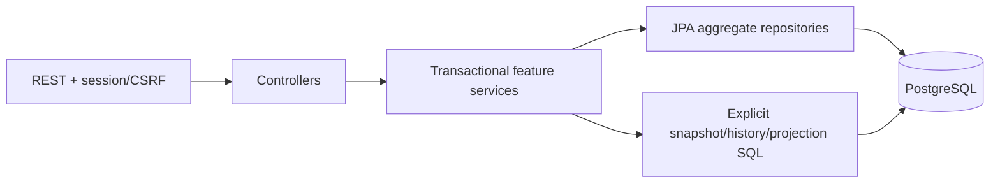
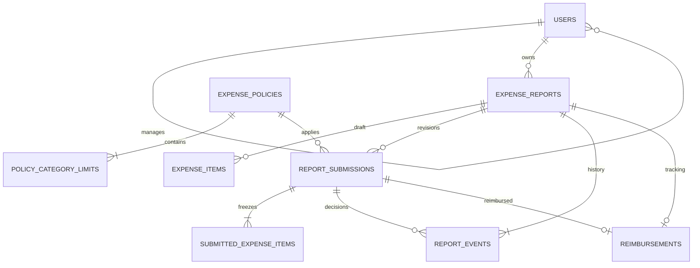

# Architecture

One Maven module, one JVM, one PostgreSQL database. Packages: `identity` owns accounts; `policy` reads seeded policy; `report` owns drafts, items and submission transactions; `review` owns decisions; `reimbursement` owns tracking; `reporting` owns SQL summaries; `common` owns errors, request IDs and transaction limits; `config` owns security.

JPA persists mutable reports/items and accounts. JDBC uses the same connection/transaction through the JPA transaction manager for native locks, immutable rows and aggregate projections. Flush before native reads when JPA changes are pending. No entities are serialized. Detail reads use repeatable-read transactions; paginated lists use explicit DTO projections with stable ID tie-breakers. Snapshot graphs use two bulk queries, rather than one query per item/submission.

Security matrix: employees create/mutate/read only their own reports; assigned managers decide current SUBMITTED reports and inspect only their assigned submission snapshots; finance reads approved/finance-stage current snapshots or its own returned-submission audit. Wrong roles return 403, hidden records 404. Identity always comes from the authenticated principal.
